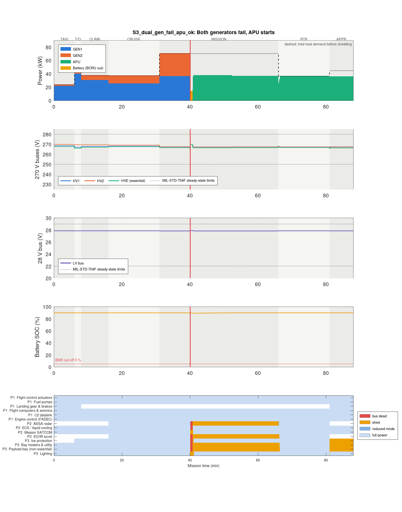
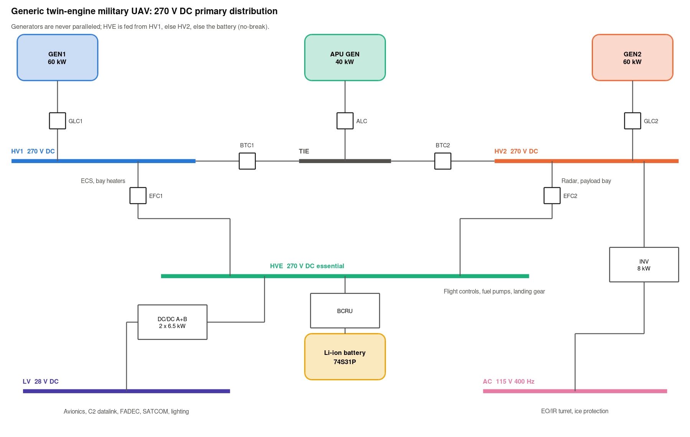

# Aircraft Electrical Power System Simulator

[](https://github.com/apalangala/aircraft-eps-sim/actions/workflows/tests.yml)

This is a MATLAB model of the 270 V DC power system on a made-up twin-engine military UAV. I wanted to see what actually sizes the parts of a "more-electric" aircraft, so I built the system and broke it in different ways.

It does three things:

- Flies a full 88-minute mission with different faults injected
- Checks the buses against MIL-STD-704F
- Uses the results to answer six design questions



*Both generators fail 40 minutes in. The battery holds the essential bus with no break. The APU comes online 45 s later. Mission and non-essential loads get shed to fit the 40 kW APU, then come back as demand drops on the way home. Flight-critical loads never lose power.*

## What I found

**Battery size.** To land after losing both generators and the APU, the pack needs to be 74S31P Li-ion. That's about 145 kg and 20.9 kWh. The 30-minute emergency only uses 8.1 kWh, so the pack is 2.6x bigger than the energy says. The reason is power, not energy. A cold, aged pack can't hold its voltage through the 25 kW landing peak at -20 °C. A pack heater would save about 56 kg. (`studies/study_battery_sizing.m`)

**Radar headroom.** With both generators, the radar can go up to 50.6 kW. But the 25 kW baseline radar already fails N-1. Lose one generator with no APU and the other one sits at 104 %, so the radar has to drop to its 50 % mode. Full N-1 needs the radar at 23.2 kW or less, or bigger generators. (`studies/study_radar_headroom.m`)

**Transients.** Load application (min 248.5 V) and load rejection (max 293.2 V) both pass MIL-STD-704F. Bus transfer failed in my first design. Reconnecting onto a collapsed bus spiked to 348 V, and the limit is 330 V. An 8 ms soft start fixed it: 305 V peak and a 41 ms interruption, under the 50 ms limit. (`studies/study_transients.m`)

**Stability.** With a plain LC input filter, the radar's power supply goes unstable above 20.3 kW. The radar runs at 25 kW, so it would oscillate. Adding an R-C damping branch makes it stable up to 80 kW. Phase margin is only 36° though. The weak spot left is the 356 Hz resonance between the generator and the bus capacitor. (`studies/study_stability.m`)

**Pulsed radar.** 50 kW bursts at 10 Hz cause 29 V of ripple. The limit is 6 V. A 255 J buffer in the radar supply fixes it, which is about 7 mF. The generator still sees 50 kW swings. Getting those down to about 6 kW, to go easy on the gearbox, needs around 1.3 kJ. (`studies/study_pulsed_radar.m`)

**Reliability.** Losing the essential bus comes out at 1.0e-7 per flight hour. The target for a catastrophic failure is 1e-9, so it's 100x off. Almost all of that is the single essential busbar. Splitting it in two gets it to 5e-10, as long as common-cause faults between the halves stay under 1 %. (`studies/study_reliability.m`)

`run_all.m` regenerates every number here into [`results/summary.md`](results/summary.md).

## How the system is set up



- Two 60 kW engine generators. Each one feeds its own 270 V main bus.
- A 40 kW APU generator that joins through a tie bus.
- Generators are never paralleled. A tie only closes to let one source carry the other side.
- An essential bus for everything flight-critical. It's fed from HV1, then HV2, then a Li-ion battery through a bidirectional converter. The battery takes over with no break.
- 28 V DC for avionics, from two converters in parallel.
- 115 V 400 Hz AC from one inverter, for the EO/IR turret and ice protection.
- 14 loads in three priority levels: flight-critical (never shed), mission, and non-essential. The radar can drop to a 50 % mode before anything mission-level gets shed.
- Load demand changes across seven mission phases.

The full truth table is in [`docs/bus_logic.md`](docs/bus_logic.md).

## Two models

One model can't do everything here, so there are two.

| | System level | Event level |
|---|---|---|
| Time step | 0.25 s, full 88 min mission | 20 µs, 0.1 to 1 s around one event |
| What's in it | Power flow, converter losses, generator thermal overload, battery model, bus manager, load shedding | Averaged generator and regulator, bus capacitance, LC filter, constant-power load |
| What it answers | Who feeds what, what gets shed, battery endurance, steady-state voltages | Transients against MIL-STD-704F, ripple, stability |

The mission model can't show a 330 V spike. The 20 µs model can't fly a mission. Each question uses whichever one can answer it.

## Running it

Works in MATLAB R2019b or newer with no toolboxes. Also works in GNU Octave 8+.

```matlab
setup_paths
run_all               % everything (about 15-20 min in Octave)
run_all noscenarios   % skip the long mission runs
run_all_tests         % just the tests (about 2 min)
```

To run one scenario:

```matlab
setup_paths
S = scenario_list();
out = run_system_sim(S(4));   % both generators fail, battery only
plot_scenario(out, 'my_run.png');
disp(out.summary)
```

Every parameter is in `config/`. Change one, rerun, and `results/summary.md` updates.

## Fault scenarios

| | Scenario | What happens |
|---|---|---|
| S0 | Nominal | Both generators around 60 % in the mission phase. Nothing shed. |
| S1 | GEN1 fails, APU starts | GEN2 carries both sides for 45 s with P3 loads shed and the radar at 50 %. Then the APU picks up HV1 and everything comes back. |
| S2 | GEN1 fails, APU fails | GEN2 alone for the rest of the flight. Radar stays at 50 % and the payload bay stays off until demand drops on the way home. |
| S3 | Both generators fail, APU starts | Battery covers 45 s. Then the APU runs flight-critical loads plus whatever mission load fits in 40 kW. |
| S4 | Both fail 30 min out, APU fails, battery at -20 °C | Battery alone to touchdown. Lands at 41 % charge. |
| S5 | One 28 V converter fails | The other one carries the 28 V bus at 97 % of its rating. Not much margin. |
| S6 | GEN2 fails on takeoff, APU starts | Takeoff load fits on one generator. Nothing shed. |

Plots for each one are in `results/figures/`.

## Testing

There are 13 tests in `tests/`. They run in MATLAB and Octave, and GitHub Actions runs them in Octave on every push. They trace back to 16 requirements in [`docs/requirements.md`](docs/requirements.md).

Some of what they check:

- Generators are never paralleled. This is checked for all 16 source combinations and at every time step of every fault run.
- Flight-critical loads never lose power.
- Shedding follows priority, and loads don't chatter on and off.
- MIL-STD-704F steady-state and transient limits.
- Battery endurance at four temperature and age corners.
- Power balance closes at every step.

One test found a real bug. The truth-table test traces power through the closed contactors. It found that with only GEN2 running, a bus tie stayed open while the code said HV1 was powered. More on that in [`docs/bus_logic.md`](docs/bus_logic.md).

## Limits

The aircraft is made up. All the numbers and where they came from are in [`docs/assumptions.md`](docs/assumptions.md). The main limits:

- Failure rates are rough orders of magnitude, not real qualified data.
- I joined the MIL-STD-704F envelope corners with straight lines. Check them against the standard before using them for anything formal.
- The event model is averaged. No switching ripple, no AC machine dynamics, and only one 270 V channel at a time.
- The bus logic is a plain MATLAB function, not Stateflow yet.

## Folder layout

```
config/        all parameters
src/models/    generator, converters, battery
src/logic/     bus manager and load shedding
src/sim/       system-level simulator
src/transient/ 270 V bus model, linearisation, impedances
src/analysis/  MIL-STD-704F checks, fault tree, Monte Carlo
src/plotting/  figures
scenarios/     fault scenarios
studies/       the six design studies
tests/         test suite
docs/          assumptions, requirements, bus logic, technical report
results/       generated figures and tables
```

## What's next

1. Move the bus manager to Stateflow and the bus model to Simscape Electrical. Then test both against the same results.
2. Add damping on the main bus to get phase margin above 45°.
3. Model the 28 V and AC buses at event level. Try a variable-frequency AC setup for comparison.
4. Swap the made-up data for supplier-style numbers. Run the bus manager on a microcontroller as hardware-in-the-loop.

## References

- MIL-STD-704F, *Aircraft Electric Power Characteristics*, US DoD, 2004
- R. D. Middlebrook, "Input filter considerations in design and application of switching regulators," IEEE IAS Annual Meeting, 1976
- R. W. Erickson and D. Maksimović, *Fundamentals of Power Electronics*
- FAA AC 25.1309-1 / EASA CS-25.1309
- I. Moir and A. Seabridge, *Aircraft Systems*, Wiley

## Licence

MIT. See [`LICENSE`](LICENSE).
