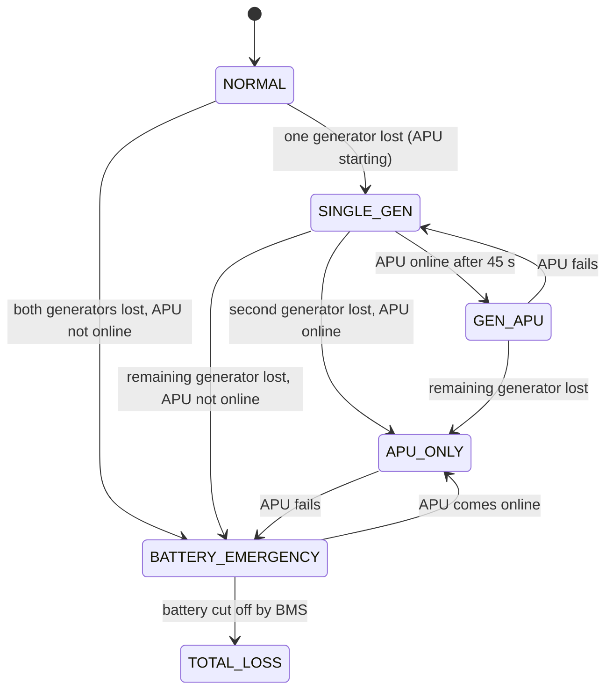

# Bus power control logic

`src/logic/bus_manager.m` is the bus power control unit. It takes the health of each source and returns the contactor states.

It is written as a **pure function of source health**. All the timing (APU start delay, shed delay, restore delay) lives in the simulator, so every input combination can be tested exhaustively. `tests/test_bus_logic_truth_table.m` checks all 16 combinations.

## Modes

## Contactor truth table

`1` = closed. Source health: G1, G2, APU online, battery available.

| G1 | G2 | APU | Mode | HV1 fed by | HV2 fed by | GLC1 | GLC2 | ALC | BTC1 | BTC2 | EFC1 | EFC2 | BLC |
|---|---|---|---|---|---|---|---|---|---|---|---|---|---|
| 1 | 1 | – | NORMAL | GEN1 | GEN2 | 1 | 1 | 0 | 0 | 0 | 1 | 0 | 0 |
| 1 | 0 | 1 | GEN+APU | GEN1 | APU | 1 | 0 | 1 | 0 | 1 | 1 | 0 | 0 |
| 0 | 1 | 1 | GEN+APU | APU | GEN2 | 0 | 1 | 1 | 1 | 0 | 1 | 0 | 0 |
| 1 | 0 | 0 | SINGLE_GEN | GEN1 | GEN1 | 1 | 0 | 0 | 1 | 1 | 1 | 0 | 0 |
| 0 | 1 | 0 | SINGLE_GEN | GEN2 | GEN2 | 0 | 1 | 0 | 1 | 1 | 1 | 0 | 0 |
| 0 | 0 | 1 | APU_ONLY | APU | APU | 0 | 0 | 1 | 1 | 1 | 1 | 0 | 0 |
| 0 | 0 | 0 | BATTERY_EMERGENCY | – | – | 0 | 0 | 0 | 0 | 0 | 0 | 0 | 1 |

The battery is shown as available. With no battery, the last row becomes TOTAL_LOSS with every contactor open.

## A bug the tests caught

The first version closed each bus tie only when *its own* side was fed through the tie. With only GEN2 running, that left BTC2 open, so HV1 was "fed by GEN2" on paper but not connected to it.

The power-flow code works from the reported feeds, so the scenario simulations still looked fine. The truth-table test traces actual connectivity through the closed contactors, and it caught the bug. The fix: a tie also closes when its own generator is carrying the *other* side.

## Porting to Stateflow

The function maps directly onto a Stateflow chart:

1. Create one state per mode above.
2. Put the transition conditions on the health inputs, as in the diagram.
3. Set the contactor outputs as entry actions, from the truth table.

Keep the timers outside the chart, in Simulink, or use `after(45, sec)` for the APU, so the chart stays testable against the same truth table. `tests/test_bus_logic_truth_table.m` can then run against the chart, called through a MATLAB Function wrapper, to show the two implementations agree.
