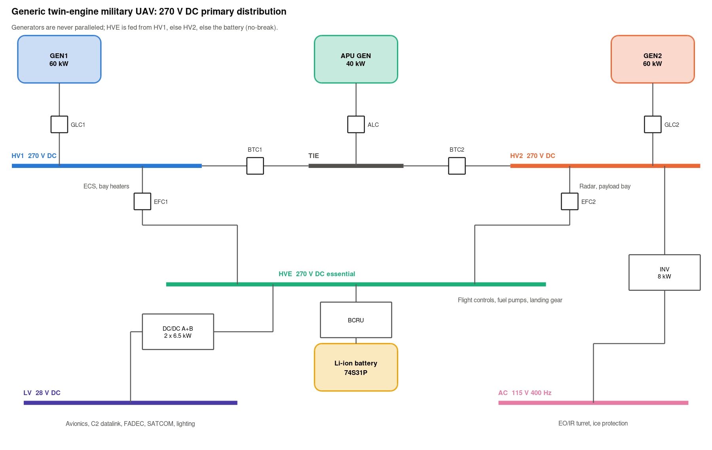
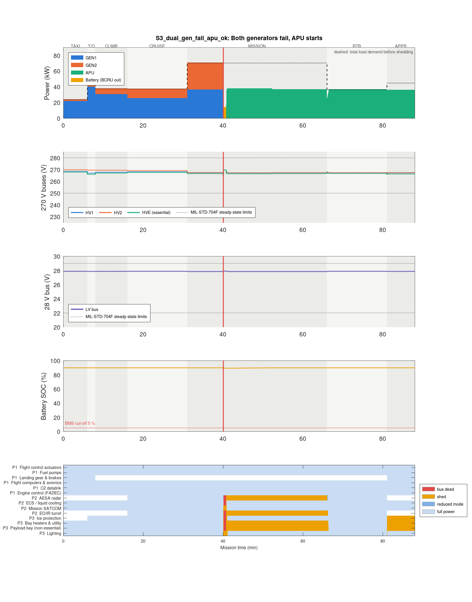
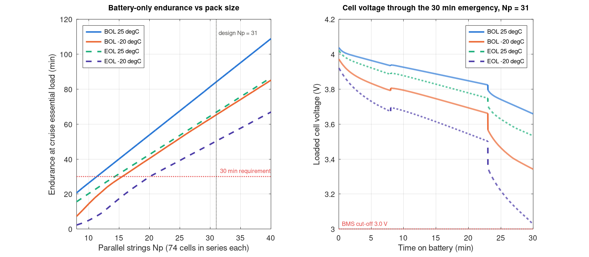
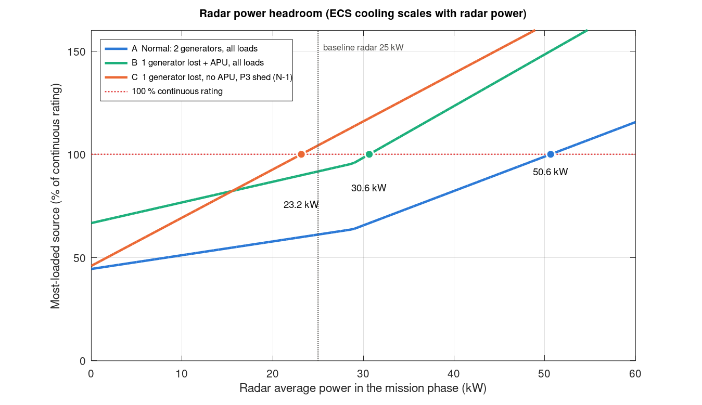
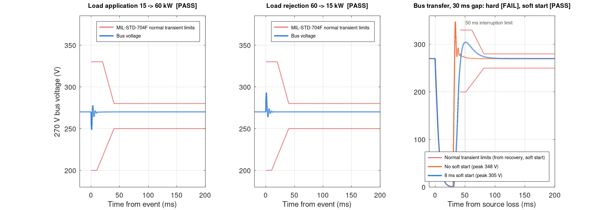
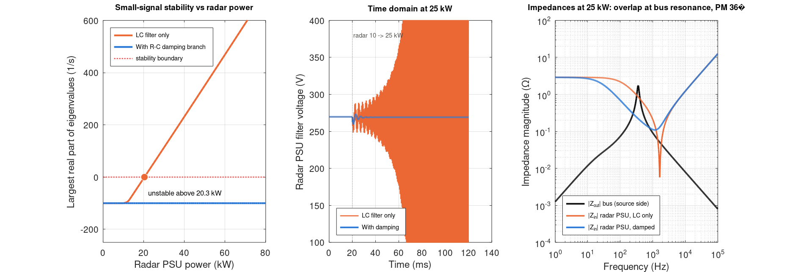
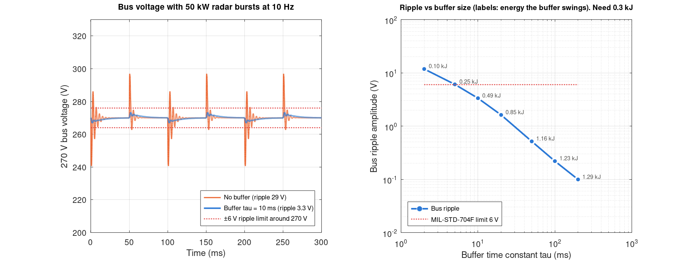
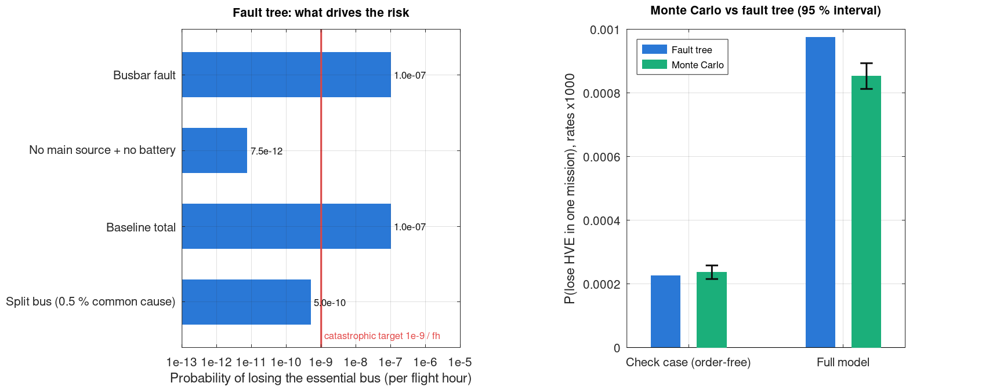

# Summary

This study models the 270 V DC electrical power system of a generic twin-engine military UAV. Two models are used:

- A **system-level simulator** flies an 88-minute mission through seven fault scenarios.
- An **event-level averaged model** checks millisecond transients and stability against MIL-STD-704F.

Six design questions are answered with numbers:

1. **Battery:** a 74S31P Li-ion pack (about 145 kg) carries the flight-critical loads for 30 minutes with both generators and the APU lost. The pack is sized by its power capability at −20 °C, not by energy. A pack heater would save about 56 kg.
2. **Radar headroom:** the system carries up to 50.6 kW of radar with both generators. The 25 kW baseline radar does **not** meet an N-1 criterion without the APU. One generator then runs at 104 %, so the radar must drop to its 50 % mode.
3. **Transients:** load application and rejection meet the MIL-STD-704F envelope. A bus transfer overshoots to 348 V unless the incoming source uses an 8 ms soft start. With it, the peak is 305 V and the interruption 41 ms.
4. **Stability:** the radar power supply's LC input filter goes unstable above 20.3 kW. An R-C damping branch fixes this, leaving a 36° phase margin at 25 kW.
5. **Pulsed radar:** unbuffered 50 kW bursts give 29 V of ripple against a 6 V limit. A 255 J buffer brings ripple within the limit.
6. **Reliability:** the single essential busbar puts loss of essential power at 1.0e-7 per flight hour. A split essential bus brings this to 5e-10.

{width=95%}

# Architecture

## Sources and buses

- Two 60 kW generators each feed their own 270 V main bus (HV1, HV2). A 40 kW APU generator connects through a tie bus.
- The bus manager never parallels two sources. When a generator is lost, its side is picked up by the APU once online (45 s), or by the other generator through the tie.
- Flight-critical 270 V loads sit on an essential bus (HVE). HVE is fed from HV1, otherwise HV2, otherwise a Li-ion battery through a bidirectional converter (BCRU). The BCRU is always connected, so the transfer to battery has no break.
- A 28 V DC bus is fed from HVE through two parallel 6.5 kW converters. A 115 V 400 Hz bus is fed from HV2 through an 8 kW inverter.

## Loads

There are 14 loads in three priority classes:

| Priority | Class | Loads | Shedding |
|---|---|---|---|
| 1 | Flight-critical | Flight controls, fuel pumps, gear and brakes, flight computers, C2 datalink, engine control | Never shed |
| 2 | Mission | Radar, cooling (ECS), SATCOM, EO/IR turret | Shed after P3. The radar has a 50 % mode |
| 3 | Non-essential | Ice protection, bay heaters, payload bay, lighting | Shed first |

Mission-phase demand is about 71 kW. During the mission, cooling follows the radar: ECS = 8 kW + 0.4 × radar power.

## Load management

A source above its continuous rating for 0.5 s, or above its overload capability at any instant, triggers shedding. Loads are dropped in a fixed order until the source is back at 95 % of rating.

A shed load returns only when it fits with a 10 % + 500 W margin for 5 s. This hysteresis keeps loads from switching on and off repeatedly at the limit.

On battery only, everything except priority-1 loads is shed to save energy.

# Method

## System-level simulator (0.25 s step)

Each step runs the following sequence:

1. Fault injection.
2. APU start sequencing.
3. The bus manager, a pure function of source health, which sets the contactors.
4. The load manager.
5. Battery charging from spare capacity.
6. State updates.

Each converter loses a fixed amount plus a part that grows with the square of power. Each generator has a first-order thermal overload model. The battery is a one-RC equivalent-circuit model with temperature and ageing corrections. Its battery-management system (BMS) cuts the pack off on low SOC, low loaded cell voltage, or over-current.

## Event-level averaged model (20 µs step)

One 270 V channel is modelled:

- The generator and rectifier are a controlled EMF behind R and L, with a PI regulator acting through an exciter lag. The regulator uses set-point feedforward and a 2.5 per-unit current limit.
- The bus has 2 mF of capacitance and a resistive load.
- The radar power supply is a constant-power load behind its LC input filter, with an optional R-C damping branch.

Stability is assessed three ways: eigenvalues of the numerically linearised model, Middlebrook impedances, and the Nyquist minor-loop gain Zout/Zin.

# Results

## Fault scenarios

In all seven scenarios:

- Flight-critical loads never lost power.
- No two sources were ever paralleled.
- Every powered bus stayed inside the MIL-STD-704F steady-state band (264–270 V and 27.7–27.9 V).

Losing one generator without the APU (S2) leaves the radar at 50 % and the payload bay off until demand falls on the return leg. In S4 the battery carries the aircraft to touchdown at −20 °C, ending at 41 % SOC.

A finding from S5: when one 28 V converter fails, the other runs at 97 % of its rating. The design works, but with almost no margin.

{width=80%}

## Battery sizing

The emergency profile is 8 min of mission, 15 min of return and a 7 min approach and landing. On battery alone it needs 14.9, 12.8 and 25.4 kW at the battery terminals, 8.1 kWh in total.

The table gives the minimum number of parallel strings at each corner:

| Corner | New, 25 °C | New, −20 °C | End of life, 25 °C | End of life, −20 °C |
|---|---|---|---|---|
| Minimum parallel strings | 15 | 23 | 19 | **31** |

In every case the pack fails on **loaded cell voltage**, not on charge. At −20 °C and end of life, cell resistance is 4.5 times its new, warm value. The 25 kW landing peak then pulls the cells below 3.0 V while about a quarter of the charge is still in the pack.

The design is therefore 74S31P: 20.9 kWh nominal and about 145 kg. Energy alone would justify less than half of that. Two alternatives would cut the mass:

- **A pack heater** holding 25 °C needs only 19P, saving about 56 kg.
- **A small supercapacitor** for the landing peak.

{width=95%}

## Radar power headroom

Radar average power is swept with cooling following it:

| Configuration | Radar limit | Binding source |
|---|---|---|
| Both generators | 50.6 kW | GEN2 |
| One generator lost, APU online | 30.6 kW | APU (when GEN2 is lost, the APU carries the radar's bus) |
| One generator lost, no APU, P3 shed | 23.2 kW | Remaining generator |

At its 25 kW baseline the radar sits just past the N-1 limit. The architecture tolerates it only because the radar has a 50 % mode. More radar power means either larger generators or accepting reduced radar after a failure. A third generator only becomes necessary beyond about 50 kW.

{width=75%}

## Transients against MIL-STD-704F

The table summarises each event:

| Event | Result | Detail |
|---|---|---|
| Load application, 25 % → 100 % | Pass | Dips to 248.5 V, back inside 250–280 V within 1.1 ms |
| Load rejection | Pass | Peaks at 293.2 V |
| Bus transfer, no soft start | Fail | Overshoots to 348 V |
| Bus transfer, 8 ms soft start | Pass | Peaks at 305 V, 41 ms interruption |

The bus transfer is the instructive case. After a 30 ms contactor transfer the bus has collapsed. A source that regulates straight to 270 V charges the bus capacitance at its current limit, and the energy in its inductance carries the voltage to 348 V, above the 330 V envelope. Ramping the incoming source's set-point over 8 ms fixes this while staying inside the 50 ms interruption limit.

The essential bus never sees this gap, because the battery converter bridges it.

{width=100%}

## Constant-power-load stability

A regulated converter draws constant power, so it presents a negative incremental resistance of −V²/P. With the radar power supply's 20 µH / 470 µF input filter:

- The ideal-source estimate R_f C_f V²/L_f gives instability at 15.4 kW.
- The full linearised model puts it at **20.3 kW**, because source resistance adds some damping.
- The time-domain model shows a growing oscillation at 1.8 kHz at 25 kW, matching the eigenvalues.

An R-C damping branch (0.2 Ω with 4 × C_f) gives stability across 0–80 kW.

The source and load impedances still overlap near the 356 Hz resonance of generator inductance with bus capacitance. Middlebrook's sufficient condition is therefore not met. The minor-loop Nyquist margin at 25 kW is 36° (vector margin 0.54). The recommended next step is damping on the main bus to bring this above 45°.

{width=100%}

## Pulsed radar

Here the radar draws 50 kW bursts at 50 % duty and 10 Hz. Passed straight to the bus, the bursts cause 29 V of ripple against the 6 V limit.

A buffer inside the radar power supply draws a low-pass-filtered version of the radar power from the bus. A 5.1 ms time constant (255 J, about 7 mF between 300 and 400 V) meets the ripple limit.

The bus ripple comes mostly from the sharp edges of each burst, so a small buffer suffices. The generator, however, still sees 50 kW swings at 10 Hz. Smoothing those to about 6 kW, to protect the gearbox, needs about 1.3 kJ.

{width=95%}

## Reliability

The top event is loss of essential-bus power. The fault tree:

- uses illustrative failure rates;
- includes common-cause loss of both generators (2 %) and a 5 % APU in-flight start failure;
- gives **1.0e-7 per flight hour**.

Nearly all of this comes from the single essential busbar. The failure of every source plus the battery path contributes only 7.5e-12.

A split essential bus, where each half can carry the flight-critical loads and has its own battery path, reduces the risk to 5e-10. That meets the 1e-9 catastrophic target provided common-cause faults between the halves stay below 1 %.

A time-resolved Monte Carlo model, run at failure rates scaled up 1000×, checks the tree:

- It agrees with the tree where event order cannot matter (2.37e-4 ± 0.21e-4 against 2.26e-4).
- It falls below the tree when APU timing is modelled, as expected, since the tree is conservative.

{width=95%}

# Verification

Thirteen automated tests cover sixteen written requirements; see `docs/requirements.md`.

One test traces actual electrical connectivity through the closed contactors for all 16 source-health combinations. It found a real logic error that the scenario plots had hidden: with only GEN2 running, a bus tie stayed open while HV1 was reported as powered. The power-flow code followed the reported feeds, so the plots looked correct.

# Limitations

- All parameters are assumptions for an invented aircraft. Failure rates are illustrative.
- MIL-STD-704F envelope corners are joined by straight lines.
- The event-level model is averaged and covers one 270 V channel at a time. It has no switching ripple and no AC machine dynamics.
- Bus logic is a MATLAB function rather than a Stateflow chart.
- Results were produced in GNU Octave 8.4. The code is written to run unchanged in MATLAB.

# References

1. MIL-STD-704F, *Aircraft Electric Power Characteristics*, US DoD, 2004.
2. R. D. Middlebrook, "Input filter considerations in design and application of switching regulators," IEEE IAS, 1976.
3. R. W. Erickson, D. Maksimović, *Fundamentals of Power Electronics*, Springer.
4. FAA AC 25.1309-1 / EASA CS-25.1309, system design and analysis.
5. I. Moir, A. Seabridge, *Aircraft Systems*, Wiley.
